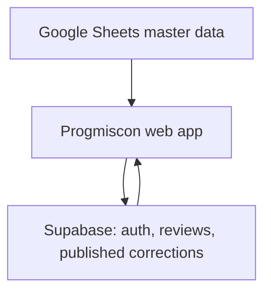

# Progmiscon

A web app for exploring introductory programming questions, the concepts behind them, and the misconceptions that show up in student answers. Lecturers can also review and correct the misconception labels on each question.

A wrong answer from a beginner is rarely random. It usually reflects a specific misunderstanding, such as execution order or expression evaluation. Progmiscon links each question to its concepts and to the misconceptions its answers can reveal, and keeps that mapping accurate through lecturer review.

I built this project on my own, from the database and data pipeline to the frontend and deployment.

## Features

- **Question bank:** browse questions by concept and week, view pseudocode, sample cases, and recorded answer variations, and filter answers by misconception
- **Concept and misconception pages:** descriptions, corrections, common causes, examples, and related questions
- **Bilingual:** Indonesian and English, switchable at any time
- **Lecturer review:** lecturers sign in with an institutional email, review a question's misconception mapping, and suggest misconceptions to add or remove. Each question takes up to three reviewers
- **Admin tools:** publish a correction once three reviewers agree, edit question content, and export content and reviews as CSV

## Architecture

The content comes from a Google Sheets workbook that acts as the master data. The app reads it, applies any published corrections stored in Supabase, and shows the result. Login, reviews, and corrections all run on Supabase.



For local development, the app can also run on bundled mock data without Google Sheets.

## Tech stack

- React 19, TypeScript, Vite
- React Router, Tailwind CSS
- Supabase for authentication and data
- PapaParse for reading Google Sheets CSV exports
- Deployed on Vercel

## How to run

Requires Node.js 22 or newer.

```bash
npm install
cp .env.example .env.local
npm run dev
```

Fill in `VITE_SUPABASE_URL` and `VITE_SUPABASE_PUBLISHABLE_KEY` in `.env.local`. Keep `VITE_DATA_SOURCE=mock` to use the bundled sample data, or set it to `sheets` and add the published CSV URL for each Google Sheets tab (`VITE_SHEET_*_URL`).

Other commands:

- `npm run build`: production build
- `npm run lint`: lint the code
- `npm run check:<name>`: run one of the check scripts in `checks/`

## Project structure

```text
src/        React app (pages, components, hooks, services, types, utils)
checks/     Check scripts and test fixtures
supabase/   Database migrations
database/   Migration archive and replay tests
scripts/    Developer tooling
docs/       Extra documentation
```

## Status

The question, concept, and misconception views, bilingual support, lecturer review, admin publishing, and CSV exports are all working. Localization coverage and content cleanup are still in progress.
